# 面向计算预算的局部—全局协同提前退出卷积神经网络

摘要：针对固定深度卷积网络在计算资源受限场景下难以按样本分配计算的问题，本文以 CIFAR ResNet-18 为骨干，在中间阶段设计局部—全局门控分类出口，结合置信度、相邻出口一致性与自蒸馏，研究多出口图像分类的准确率与计算成本。在 CIFAR-100 上，以三个随机种子训练五组模型，并固定验证集确定的退出策略后进行测试。65% 目标预算下，融合加蒸馏模型的测试准确率为 75.32% ± 0.19%，实际平均计算比为 64.36% ± 0.69%；完整单出口基线准确率为 77.19% ± 0.05%。在本文测量条件下，GPU 动态推理的单张延迟未随计算量降低而下降，表明部署时需要联合考虑路由开销与硬件特性。

关键词：卷积神经网络；提前退出；计算预算；特征融合；知识蒸馏

## 引言

图像分类网络通常为所有输入执行相同深度的特征提取，而图像的判别难度并不一致。计算预算受限时，依据中间预测决定是否继续执行网络，可以将计算资源分配给需要进一步辨别的样本。提前退出网络通过在骨干中间阶段增加分类分支实现这种按需推理，其性能取决于中间表征的判别能力与退出决策的可靠性。

残差网络利用恒等映射与残差分支构建深层特征提取路径[1]，为研究不同深度的表征提供了清晰的结构基础。BranchyNet 在网络内部设置辅助分类器，通过提前终止推理减少计算[2]；MSDNet 将多尺度表征与多出口组织相结合，研究资源约束下的识别[3]。Shallow-Deep Networks 进一步指出，更深层预测并非总能修正浅层结果，部分样本会发生正确预测被后续层改变的现象[4]。因此，提前退出需要同时考虑正确分类、计算成本与错误早退之间的关系。

本文围绕残差 CNN 的中间出口构建局部—全局协同分类结构。出口在保留全局平均表征的同时，通过深度卷积和空间加权汇聚提取局部响应，并以通道门控形成融合特征。推理阶段依据当前置信度与已执行出口的类别一致性作出决策，已退出样本不再进入后续阶段。实验围绕同等计算预算下的识别质量展开，分别检验出口结构、因果决策与蒸馏训练的作用，并将理论计算量与实际执行延迟分开评价。

## 1 相关工作

提前退出的基础机制、中间表征设计与训练辅助分别构成三条相关研究线索。BranchyNet 和 Shallow-Deep Networks 提供多出口与置信度决策的基础[2,4]，MSDNet 体现了中间表征与预算适配的协同设计[3]。蒸馏训练能够利用不同深度分类器之间的预测关系改善多出口训练[5]。LGViT 面向视觉 Transformer 设计异构出口，其局部感知头通过卷积提取局部表征并与 CLS 特征相加[6]。本文以经典残差 CNN 为研究对象，通过空间加权汇聚与通道门控组织出口特征，并以近等参数容量对照分析具体结构的作用。

退出决策方面，PABEE 根据连续内部预测的一致性决定是否终止计算[8]；PCEE-BERT 将置信度与连续层判据结合[9]。本文采用当前置信度与相邻已执行出口类别一致的组合条件，通过固定权重的策略消融评价计算分配。置信度使用验证集温度缩放进行校准[7]，校准效果与退出收益分别检验。

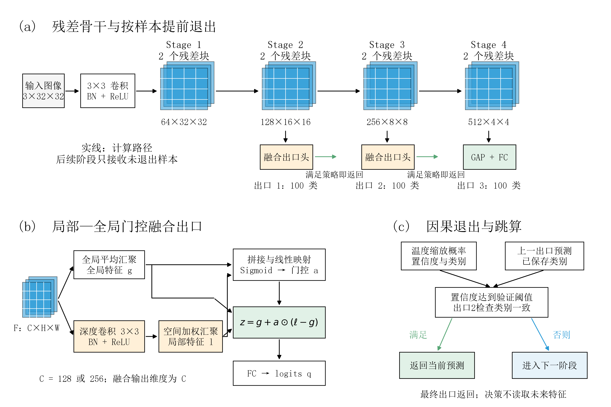

## 2 局部—全局协同提前退出网络

### 2.1 残差骨干与多出口结构

骨干采用适配 CIFAR 图像尺寸的 ResNet-18。输入为三通道 32×32 图像，起始层使用步长为 1 的 3×3 卷积，并移除原始大图结构的初始最大池化。四个阶段均包含两个基本残差块，输出张量依次为 64×32×32、128×16×16、256×8×8 和 512×4×4。基本残差块计算为

\[
\boldsymbol{x}_{l+1}=\operatorname{ReLU}\big(\mathcal{F}(\boldsymbol{x}_l)+\mathcal{S}(\boldsymbol{x}_l)\big),
\]

其中，\(\mathcal{F}\) 由两层 3×3 卷积及批归一化构成，第一层卷积后使用 ReLU；\(\mathcal{S}\) 在尺寸一致时为恒等映射，在下采样或通道数变化时采用 1×1 卷积及批归一化。第二、第三阶段后设置辅助出口，第四阶段后保留全局平均池化与线性分类器，形成三个按深度排序的预测位置。

### 2.2 局部—全局门控出口

设某辅助出口输入特征为 \(F\in\mathbb{R}^{C\times H\times W}\)。全局分支采用平均汇聚：

\[
g_c=\frac{1}{HW}\sum_{u,v}F_{cuv}.
\]

局部分支先进行 3×3 深度卷积、批归一化和 ReLU，得到 \(L\)。对 \(L\) 使用 1×1 卷积生成空间评分 \(s_{uv}\)，沿空间维进行 softmax，并汇聚各位置响应：

\[
w_{uv}=\frac{\exp(s_{uv})}{\sum_{u',v'}\exp(s_{u'v'})},\qquad
\ell_c=\sum_{u,v}w_{uv}L_{cuv}.
\]

融合门控由两个分支的拼接特征生成：

\[
\boldsymbol{a}=\sigma\big(W_a[\boldsymbol{g};\boldsymbol{\ell}]+\boldsymbol{b}_a\big),\qquad
\boldsymbol{z}=\boldsymbol{g}+\boldsymbol{a}\odot(\boldsymbol{\ell}-\boldsymbol{g}).
\]

其中 \(\boldsymbol{a}\in(0,1)^C\)，\(\odot\) 表示逐元素乘法。融合特征经线性分类器得到类别 logits。该出口结构的实验评价采用 GAP-linear 与近等参数 MLP 对照，以分别检验局部信息引入和容量变化的作用。

### 2.3 多出口训练

令三个出口的 logits 为 \(q^{(j)}\)，真实标签为 \(y\)。基础训练目标为各出口交叉熵的平均值。蒸馏扩展以最终出口的停止梯度预测作为教师，仅向前两个出口传递软标签监督：

\[
\mathcal{L}=\frac{1}{3}\sum_{j=1}^{3}\operatorname{CE}(q^{(j)},y)
+\lambda\frac{T^2}{2}\sum_{j=1}^{2}\operatorname{KL}\left(
\operatorname{softmax}(\operatorname{sg}(q^{(3)})/T)
\;\|\;\operatorname{softmax}(q^{(j)}/T)\right).
\]

\(T\) 为蒸馏温度，\(\operatorname{sg}\) 为停止梯度运算。不使用蒸馏的结构对照设置 \(\lambda=0\)。蒸馏属于独立训练辅助，结构贡献由无蒸馏对照判断。

### 2.4 因果一致性决策与动态执行

第 \(j\) 个出口使用验证校准集拟合的温度 \(\tau_j\)，得到概率 \(p^{(j)}=\operatorname{softmax}(q^{(j)}/\tau_j)\)。定义置信度 \(c_j=\max_kp_k^{(j)}\) 和预测类别 \(\hat y_j=\arg\max_kp_k^{(j)}\)。置信度基线在 \(c_j\geq\theta_j\) 时退出；一致性策略在第二出口增加 \(\hat y_2=\hat y_1\) 的条件，第一出口仍使用置信度条件。未满足条件的样本继续进入下一阶段，最终出口直接返回预测。

一致性条件只使用当前及此前已执行出口，不需要深层预测。实现中维护活动样本索引，在每次决策后压缩特征批次，后续残差阶段只处理尚未退出的样本。计算量统计计入路径上已经执行的全部出口头；实际延迟同时包含活动批次管理与分支判断开销。

### 2.5 预算约束下的策略选择

对第 \(i\) 个样本记退出位置为 \(e_i\)，执行至该出口的累计成本为 \(M_{e_i}\)。平均相对计算成本定义为

\[
\rho=\frac{1}{N M_{\mathrm{base}}}\sum_{i=1}^{N}M_{e_i},
\]

其中 \(M_{\mathrm{base}}\) 为单出口骨干完整前向的 MACs。验证策略选择集上，在预设 \(\rho\leq B\) 的候选策略中选择准确率最高者，准确率相同时选择计算成本较低者。测试阶段固定模型、温度和阈值，报告测试集实际准确率与实际平均成本。该约束对应样本分布上的平均预算。

候选阈值由验证置信度的 21 个分位点与两个边界值构成。这里的最优策略定义在有限候选网格与验证样本上。路径平均成本可以等价写成各阶段增量成本乘以到达该阶段的频率再求和。提前退出比较的是继续计算可能带来的纠错收益和新增成本，置信度与相邻预测一致性是推理时序上可获得的经验判据。

## 3 实验设置

### 3.1 数据与训练协议

采用 CIFAR-100 图像分类任务检验预算约束下的多出口识别。图像尺寸为 32×32，包含 100 个类别。官方训练数据按类别分层划分为训练集、温度校准集和策略选择集；官方测试集留作冻结后的最终评价。各方法使用同一固定划分。训练图像采用边缘填充后的随机裁剪和随机水平翻转，验证和测试不使用随机增强。

以手写 CIFAR ResNet-18 为经典基线，在第二、第三残差阶段后加入辅助分类器。模型从零训练，采用 SGD、Nesterov 动量与余弦学习率调度。各结构采用相同轮数、批量大小、数据增强及随机种子集合。多出口结构的基础目标为各出口交叉熵的均值，蒸馏作为独立控制变量。单出口模型按验证准确率选择检查点，多出口模型按验证出口平均准确率选择检查点，选择规则在训练前确定。

温度缩放以校准子集的负对数似然为目标。退出阈值在策略选择子集上搜索，选择满足预设平均计算预算的准确率最高策略；若准确率相同，则选择计算成本更低者。模型权重、温度与阈值在官方测试前冻结。

训练与计时在 Windows 11 环境下执行，处理器为 Intel Core i7-14650HX，显卡为 NVIDIA GeForce RTX 4060 Laptop GPU，使用 Python 3.12.14、PyTorch 2.5.1 和 CUDA 12.1。部署计时使用 FP32，CPU 计时设置 6 个线程。

补充分析在原始实验结果公开后开展，使用相同的测试预测缓存和已冻结权重。新的阈值只在验证策略选择子集拟合，所得测试比较属于同一数据集上的补充诊断。训练期间合并使用两个验证子集选择检查点，之后分别进行温度拟合和阈值选择。

### 3.2 结构与决策对照

结构实验依次设置 GAP-linear 出口、近等参数 MLP 出口和局部—全局门控出口。GAP 对照检验加入局部表征后的识别变化，MLP 对照用于区分结构组织与参数容量的影响。融合出口再设置有、无自蒸馏两种训练条件，避免把训练辅助的作用归于出口结构。

决策实验在相同模型权重上对比置信度策略与置信度—相邻一致性策略。固定出口控制使用共享训练的同一网络，分别在第一、第二和最终出口终止，以说明动态计算分配与固定执行深度的区别。所有路径成本均包含已经执行的出口头。

### 3.3 评价指标与执行口径

主要评价为测试准确率与实际平均 MACs。预算比以独立单出口骨干的完整前向成本为分母，报告验证目标预算与测试实际成本，反映固定策略在新样本上的计算分配。MACs 统计卷积、线性层及空间加权汇聚，实际部署延迟额外包含归一化、激活和路由管理等操作。

每组模型使用三个预先固定的独立训练种子，报告逐种子结果、均值和样本标准差。结构、策略与蒸馏对照在相同种子上配对呈现，避免以单次最优值替代重复实验。CPU 与 GPU 分别测量批量为 1 的交互延迟和较大批量吞吐；计时使用预先固定的验证样本，包含设备同步与动态批次管理，不含磁盘读取、图像解码及主机到设备的数据传输。

表 1 数据划分与模型训练设置

| 项目 | 设置 |
| --- | --- |
| 数据划分（训练/温度校准/策略选择） | 45,000 / 2,500 / 2,500 |
| 训练随机种子 | 17 / 42 / 73 |
| 模型组数与训练次数 | 5 组 / 15 次 |
| 训练轮次 / 批量大小 | 160 / 128 |
| SGD 初始学习率 / 权重衰减 | 0.1 / 0.0005 |
| 动量与学习率调度 | Nesterov 0.9；前 5 轮预热，随后余弦衰减 |
| 自蒸馏温度 / 系数 | 3 / 0.5（仅融合+蒸馏组） |
| 模型选择准则 | 单出口：验证准确率；多出口：各出口验证准确率均值 |
| 混合精度 | CUDA 训练启用；验证预测缓存与正式推理采用 FP32 |

表 2 网络参数量与累计路径计算量

| 结构 | 参数量 | 出口 1 MACs/M | 出口 2 MACs/M | 完整 MACs/M |
| --- | --- | --- | --- | --- |
| 单出口 ResNet-18 | 11,220,132 | — | — | 555.469 |
| GAP 多出口 | 11,258,732 | 286.995 | 421.238 | 555.507 |
| 近等参数 MLP | 11,427,442 | 287.029 | 421.406 | 555.675 |
| 局部—全局融合 | 11,427,566 | 287.388 | 421.943 | 556.212 |

## 4 实验结果与分析

以下分类和计算量结果来自冻结策略后的 CIFAR-100 测试集；表 3、表 4 由 `paper/build_tables.py` 根据三次独立训练的汇总结果生成。准确率与计算量均报告均值和样本标准差。预算是在验证集上选择策略时使用的目标，实际计算比在测试集重新统计，分母为单出口 ResNet-18 的完整前向 MACs。

表 3 预设预算下的分类与实测计算量（均值 ± 样本标准差）

| 模型 | 策略 | 验证目标预算 | 测试准确率/% | 测试实际计算比/% |
| --- | --- | --- | --- | --- |
| 单出口基线 | 完整网络 | — | 77.19 ± 0.05 | 100.00 ± 0.00 |
| GAP 多出口 | 置信度 | 65% | 74.73 ± 0.26 | 64.94 ± 0.13 |
| 近等参数 MLP | 置信度 | 65% | 74.12 ± 0.25 | 65.00 ± 0.14 |
| 局部—全局融合 | 置信度 | 65% | 74.23 ± 0.25 | 64.83 ± 0.88 |
| 融合 + 蒸馏 | 置信度 | 65% | 75.32 ± 0.19 | 64.36 ± 0.69 |
| 融合 + 蒸馏 | 置信度+一致性 | 65% | 74.85 ± 0.29 | 64.91 ± 0.67 |
| GAP 多出口 | 置信度 | 75% | 74.73 ± 0.12 | 70.58 ± 2.99 |
| 近等参数 MLP | 置信度 | 75% | 74.31 ± 0.18 | 71.19 ± 2.48 |
| 局部—全局融合 | 置信度 | 75% | 75.96 ± 0.24 | 74.53 ± 0.22 |
| 融合 + 蒸馏 | 置信度 | 75% | 75.68 ± 0.19 | 71.36 ± 3.63 |
| 融合 + 蒸馏 | 置信度+一致性 | 75% | 75.76 ± 0.07 | 73.14 ± 0.97 |
| GAP 多出口 | 置信度 | 85% | 74.73 ± 0.12 | 70.58 ± 2.99 |
| 近等参数 MLP | 置信度 | 85% | 74.31 ± 0.18 | 71.19 ± 2.48 |
| 局部—全局融合 | 置信度 | 85% | 76.28 ± 0.23 | 83.60 ± 1.68 |
| 融合 + 蒸馏 | 置信度 | 85% | 75.69 ± 0.19 | 72.05 ± 4.73 |
| 融合 + 蒸馏 | 置信度+一致性 | 85% | 75.76 ± 0.07 | 74.30 ± 2.85 |

## 4.1 按预算分配计算

在 65% 目标预算下，局部—全局融合结合自蒸馏和置信度退出达到 **75.32% ± 0.19%** 的测试准确率，实际平均计算比为 **64.36% ± 0.69%**；同一预算下 GAP 多出口为 74.73% ± 0.26%，计算比为 64.94% ± 0.13%。这一结果表明，在本实验设置下，融合与蒸馏的组合可以在相近计算预算下提高分类准确率。作为完整网络参照，单出口基线的准确率为 77.19% ± 0.05%，计算比为 100%。因此该预算点节省计算的同时伴随准确率变化，二者共同构成部署选择。

目标预算提高至 75% 时，无蒸馏的局部—全局模型达到 **75.96% ± 0.24%**，实际计算比为 **74.53% ± 0.22%**。相同目标预算下，融合加蒸馏模型以 71.36% ± 3.63% 的实际计算比得到 75.68% ± 0.19%。目标预算是上界而非强制消耗量：策略可能在达到目标前已选择更早的出口，因此应以测试实际计算比解释不同方法的对比。

在 75% 目标预算下，融合头相对 GAP 头的同种子准确率差为 +1.23 ± 0.12 个百分点，实际计算比差为 +3.95 ± 2.98 个百分点（图 4）；这一对照同时呈现识别与计算差异，并不将目标预算相同等同于实际成本相同。

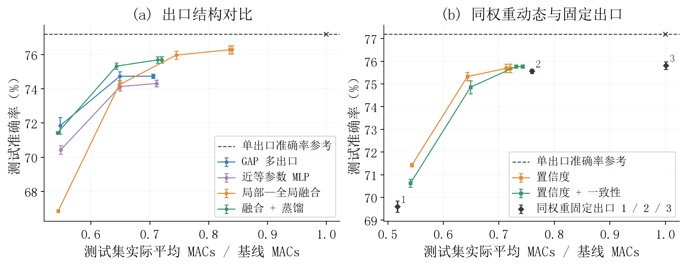

表 4 各出口测试准确率（%，均值 ± 样本标准差）

| 结构及训练方式 | 出口 1 | 出口 2 | 最终出口 |
| --- | --- | --- | --- |
| 单出口 ResNet-18 | — | — | 77.19 ± 0.05 |
| GAP 多出口 | 70.63 ± 0.48 | 74.94 ± 0.12 | 74.68 ± 0.25 |
| 近等参数 MLP | 68.93 ± 0.45 | 74.35 ± 0.19 | 74.56 ± 0.12 |
| 局部—全局融合 | 64.40 ± 0.13 | 75.19 ± 0.11 | 76.31 ± 0.23 |
| 融合 + 蒸馏 | 69.59 ± 0.25 | 75.56 ± 0.10 | 75.81 ± 0.17 |

## 4.2 出口特征与蒸馏

表 4 显示，局部—全局融合模型的第二出口和最终出口分别达到 **75.19% ± 0.11%** 和 **76.31% ± 0.23%**，高于 GAP 多出口对应的 74.94% ± 0.12% 和 74.68% ± 0.25%。近等参数 MLP 的对应结果为 74.35% ± 0.19% 和 74.56% ± 0.12%，为分析出口组织方式提供了容量对照。

加入自蒸馏后，融合模型第一出口由 **64.40% ± 0.13%** 提高至 **69.59% ± 0.25%**，第二出口由 75.19% ± 0.11% 提高至 75.56% ± 0.10%；最终出口从 76.31% ± 0.23% 变为 75.81% ± 0.17%。无蒸馏融合第一出口为 64.40%，低于 GAP 的 70.63%。这些结果说明蒸馏对融合模型的浅层出口帮助最突出，同时不同深度的识别表现存在权衡。结合 65% 预算结果，浅层判别能力的提高为低计算量下的提前退出提供了实验依据；退出比例可由策略明细进一步解释。

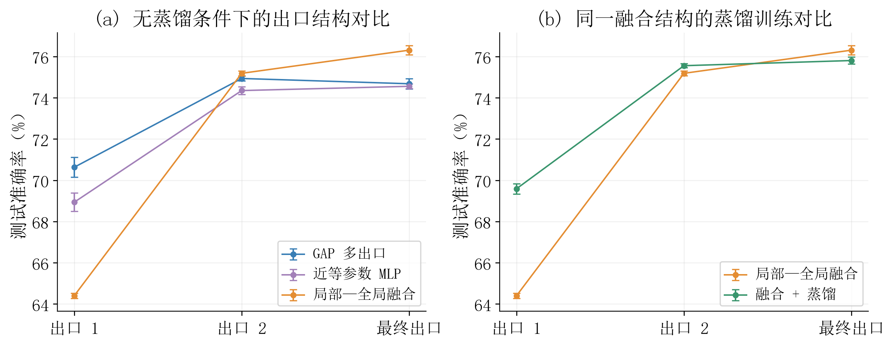

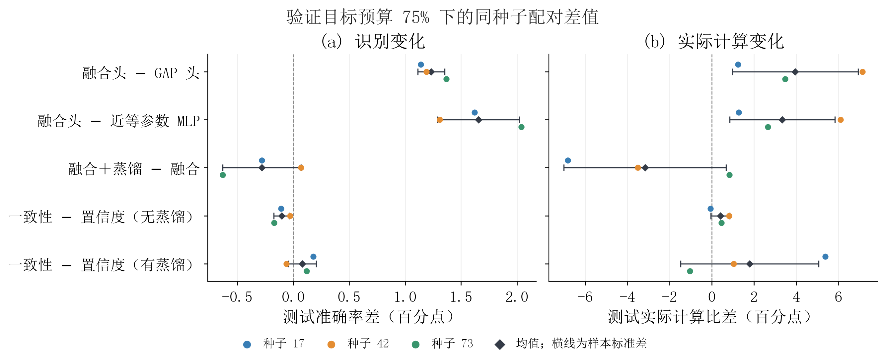

## 4.3 退出策略与实际执行

相同融合加蒸馏权重在 65% 目标预算下，置信度策略得到 75.32% ± 0.19%，置信度加相邻出口一致性策略得到 74.85% ± 0.29%；两者实际计算比分别为 64.36% ± 0.69% 和 64.91% ± 0.67%。一致性约束改变了退出条件，不能仅凭该规则假定其必然提高准确率。各预算的完整结果见表 3；相应的退出分布展示于图 5。

在 65% 目标预算下，三个出口平均接收测试样本的 51.24%、45.40% 和 3.36%。相对同权重最终出口，提前退出使 2.02% 的全部样本由正确变为错误，同时使 1.54% 的全部样本由错误变为正确；两者差额对应动态准确率相对最终出口的变化。这些数值为三个种子的均值，分母均为各自全部测试样本。

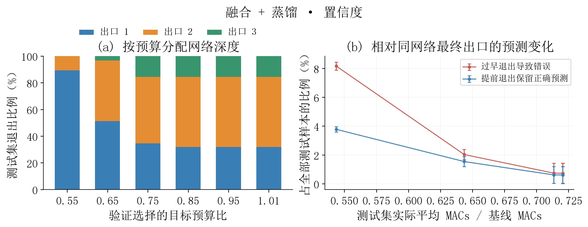

图中部署计时采用种子 42 的模型及固定的 256 张验证样本，分别测量 CPU/GPU、批量 1 和 32；每组预热 32 次、重复 3 次，计时包含动态路由与设备同步，不包含图像解码和数据传输。该实验反映特定设备、样本和实现下的执行表现，不代表三个独立训练种子的统计结果。所有 36 个配置的动态退出位置均与缓存预测一致。

在 GPU 单张测试中，单出口基线的批处理延迟中位数为 **1.5508 ms**，75% 目标预算的融合加蒸馏置信度策略为 **3.0704 ms**，后者在计时样本上的平均计算比为 **71.88%**。这一对照表明，降低 MACs 并不必然缩短该设备上的单张延迟；动态分支、批次重组等执行开销需要结合实现与硬件讨论，现有计时不能单独确定各项开销的贡献。

CPU 单张原始基线计时中位数为 34.2653 ms，样本内波动显著；相同配置的独立诊断复测得到 5.5764 ms。由于两次测量相差较大，原始测量保留在完整部署图和结果文件中，复测单独存档；本报告不据此计算或宣称 CPU 加速倍数。后续若以 CPU 加速为主要结论，应采用隔离系统负载、交错运行和多轮重复的测量设计。

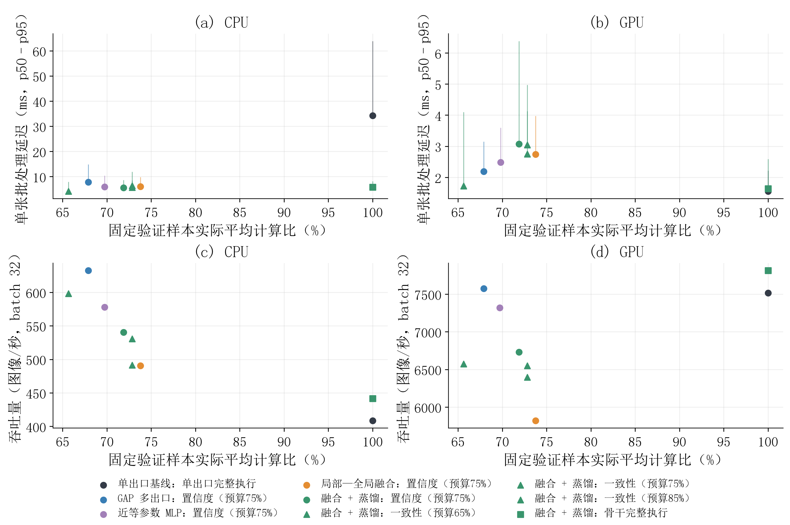

## 4.4 预算约束下的分类应用示例

图 7 展示种子 42 融合加蒸馏模型在 75% 目标预算下采用置信度策略处理验证图像的路径。样本按出口位置和预测正误分层，每个非空层选取原始索引最小的图像；这组示例用于说明路径，不用于估计整体准确率。程序以真实动态前向记录各残差阶段访问次数，并逐例核对缓存预测。第一、第二和最终出口的累计成本分别为 287.388 M、421.943 M 和 556.212 M MACs；最终出口包含前两个辅助头的开销。

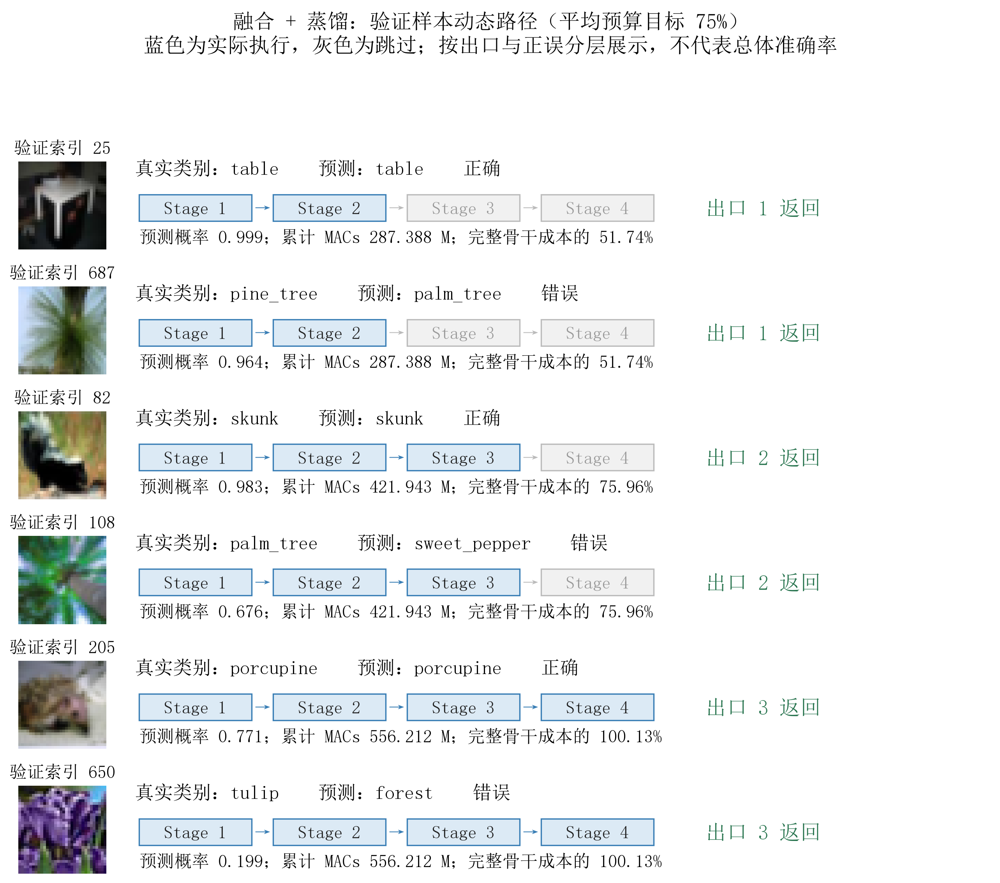
## 4.5 预算达标与计算成本对照

按种子核对全部预算策略，共有 9/144 个组合在测试集超出各自验证目标。表 5 单列置信度策略，其中最大超额按三个种子中的最大正偏差计算。55% 目标下，GAP 的准确率高于融合蒸馏组。两者在 65% 目标下的排序反转，说明组合收益取决于预算。

表 5 置信度策略的测试预算达标情况

| 目标 | 模型 | 准确率/% | 计算比/% | 达标 | 最大超额/百分点 |
| --- | --- | --- | --- | --- | --- |
| 55% | GAP | 71.83 | 54.79 | 3/3 | 0.00 |
| 55% | 近等参数 MLP | 70.42 | 54.88 | 2/3 | 0.24 |
| 55% | 局部—全局 | 66.85 | 54.46 | 3/3 | 0.00 |
| 55% | 局部—全局＋蒸馏 | 71.42 | 54.36 | 3/3 | 0.00 |
| 65% | GAP | 74.73 | 64.94 | 2/3 | 0.05 |
| 65% | 近等参数 MLP | 74.12 | 65.00 | 2/3 | 0.15 |
| 65% | 局部—全局 | 74.23 | 64.83 | 1/3 | 0.47 |
| 65% | 局部—全局＋蒸馏 | 75.32 | 64.36 | 2/3 | 0.16 |
| 75% | GAP | 74.73 | 70.58 | 3/3 | 0.00 |
| 75% | 近等参数 MLP | 74.31 | 71.19 | 3/3 | 0.00 |
| 75% | 局部—全局 | 75.96 | 74.53 | 3/3 | 0.00 |
| 75% | 局部—全局＋蒸馏 | 75.68 | 71.36 | 2/3 | 0.11 |
| 85% | GAP | 74.73 | 70.58 | 3/3 | 0.00 |
| 85% | 近等参数 MLP | 74.31 | 71.19 | 3/3 | 0.00 |
| 85% | 局部—全局 | 76.28 | 83.60 | 3/3 | 0.00 |
| 85% | 局部—全局＋蒸馏 | 75.69 | 72.05 | 3/3 | 0.00 |

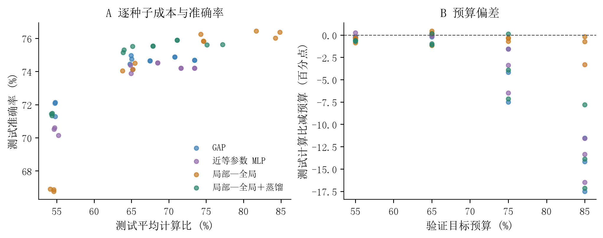

进一步在验证策略选择子集上，将候选策略的实际计算比限制在目标下方 0.5 个百分点内，再选择验证准确率最高的阈值。表 6 记录各组能找到候选的种子数，并给出测试端实际落点。少于三个种子的组按可用种子汇总，跨组比较时应核对种子构成。计算带宽约束施加在验证端，测试端成本可随样本分布变化。

表 6 验证成本对齐后的测试结果

| 目标 | 模型 | 可用种子 | 验证成本/% | 测试成本/% | 准确率/% |
| --- | --- | --- | --- | --- | --- |
| 65% | GAP | 3/3 | 64.92 | 64.94 | 74.73 |
| 65% | 近等参数 MLP | 3/3 | 64.95 | 65.00 | 74.12 |
| 65% | 局部—全局 | 3/3 | 64.90 | 65.12 | 74.21 |
| 65% | 局部—全局＋蒸馏 | 3/3 | 64.89 | 65.14 | 75.44 |
| 75% | GAP | 3/3 | 74.65 | 74.90 | 74.74 |
| 75% | 近等参数 MLP | 3/3 | 74.70 | 74.84 | 74.35 |
| 75% | 局部—全局 | 3/3 | 74.58 | 74.72 | 75.96 |
| 75% | 局部—全局＋蒸馏 | 3/3 | 74.66 | 74.93 | 75.74 |

65% 附近的成本对齐比较支持融合蒸馏组合在这一预算邻域的准确率收益。75% 附近无蒸馏融合组也高于 GAP，说明结构效果随预算变化。这些点与原表 3 的策略选择目标不同，允许对齐策略为接近指定成本放弃一部分验证集准确率。

## 4.6 校准与退出可靠性

在相同权重上，将未校准置信度重新用验证策略选择子集搜索阈值，与原温度校准策略比较。表 7 同时报告准确率和实际成本，校准收益随出口和预算而变。表 8 的 ECE 和 NLL 在验证策略选择子集计算，覆盖率与条件错误率则在冻结策略的测试样本上计算。条件错误率只对实际在对应出口返回的样本取平均，未在该出口返回样本的种子不参与条件错误率汇总。

表 7 校准前后重新选择置信度阈值的测试结果

| 目标 | 模型 | 校准前准确率/% | 校准前成本/% | 校准后准确率/% | 校准后成本/% |
| --- | --- | --- | --- | --- | --- |
| 55% | GAP | 71.78 | 54.75 | 71.83 | 54.79 |
| 55% | 局部—全局＋蒸馏 | 71.41 | 54.37 | 71.42 | 54.36 |
| 65% | GAP | 74.71 | 64.91 | 74.73 | 64.94 |
| 65% | 局部—全局＋蒸馏 | 75.27 | 64.27 | 75.32 | 64.36 |
| 75% | GAP | 74.67 | 70.14 | 74.73 | 70.58 |
| 75% | 局部—全局＋蒸馏 | 75.68 | 71.43 | 75.68 | 71.36 |

表 8 融合蒸馏模型的分出口可靠性与实际路由

| 出口 | 原始 ECE/% | 校准 ECE/% | 原始 NLL | 校准 NLL | 覆盖率/% | 错误率/% | 错误率种子 |
| --- | --- | --- | --- | --- | --- | --- | --- |
| 1 | 3.52 | 3.93 | 1.172 | 1.172 | 51.24 | 8.22 | 3/3 |
| 2 | 8.03 | 5.38 | 0.999 | 0.983 | 45.40 | 39.20 | 3/3 |
| 3 | 13.76 | 6.05 | 1.126 | 1.023 | 3.36 | 72.10 | 1/3 |

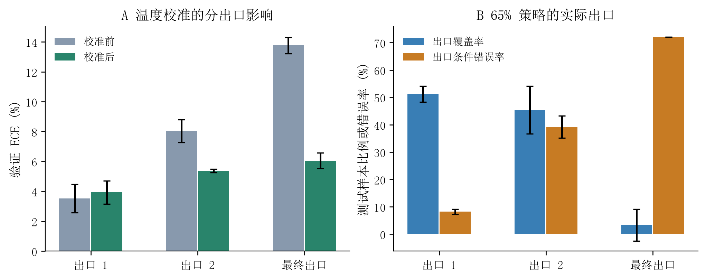

在 65% 主策略的测试退出计数下，随机分配相同数量样本到各出口的期望准确率为 72.51%，置信度路由实际为 75.32%。随机对照使用测试退出计数固定算力，只用于回顾性机制诊断。相对同权重最终出口，第一、第二出口每万张样本的有害与有益早退平均计数依次为 80.7/52.0, 121.7/101.7。

为检验一致性的附加信息，表 9 对实际到达第二出口的样本按第二出口置信度分箱，并分开汇总预测一致与不一致时的正确率。同一样本在多个种子上重复出现，表内合计仅作描述。分箱后的关联可解释一致性判据的行为，其策略收益仍需结合预算和覆盖率判断。

表 9 到达第二出口的样本按置信度和一致性分组

| 置信度区间 | 不一致计数 | 不一致准确率/% | 一致计数 | 一致准确率/% |
| --- | --- | --- | --- | --- |
| 0.00–0.50 | 3272 | 27.75 | 1683 | 40.40 |
| 0.50–0.70 | 1254 | 46.81 | 1316 | 56.53 |
| 0.70–0.85 | 832 | 55.77 | 1336 | 69.91 |
| 0.85–0.95 | 684 | 72.37 | 1657 | 80.08 |
| 0.95–1.00 | 427 | 88.52 | 2167 | 89.85 |

## 4.7 65% 主策略的交错计时

补测固定种子 42 的融合蒸馏权重和验证选择的 256 张图像，在 CPU 与 GPU、批量 1 与 32 下执行。每种路径预热 32 批，随后用轮换顺序交错测量五轮。固定浅层直接执行至指定出口，完整骨干绕过辅助头，动态路径则包含置信度判断、索引和实际退出。所有动态预测及退出位置与同输入全前向模拟一致。

GPU 批量 1 时，65% 动态策略和同权重完整骨干的每轮 p50 均值分别为 2.342 和 2.038 ms，该计时子集上动态路径的实际平均计算比为 65.93%。各轮测量使用同一模型和输入，描述当前机器上的计时波动。固定路径对照有助于观察实际执行差异，路由开销的精确归因还需分段分析。

表 10 交错计时的五轮均值

| 设备 | 批量 | 路径 | p50/ms | p95/ms | 吞吐/张每秒 |
| --- | --- | --- | --- | --- | --- |
| CPU | 1 | 单出口基线 | 8.015 | 10.877 | 122 |
| CPU | 1 | 同权重完整骨干 | 8.079 | 10.389 | 122 |
| CPU | 1 | 固定出口 1 | 4.495 | 7.489 | 210 |
| CPU | 1 | 固定出口 2 | 6.584 | 9.013 | 148 |
| CPU | 1 | 动态 65% | 6.197 | 10.745 | 150 |
| CUDA | 1 | 单出口基线 | 2.020 | 2.997 | 467 |
| CUDA | 1 | 同权重完整骨干 | 2.038 | 2.941 | 468 |
| CUDA | 1 | 固定出口 1 | 0.977 | 1.679 | 951 |
| CUDA | 1 | 固定出口 2 | 1.341 | 2.154 | 701 |
| CUDA | 1 | 动态 65% | 2.342 | 5.078 | 383 |
| CPU | 32 | 单出口基线 | 95.800 | 103.204 | 333 |
| CPU | 32 | 同权重完整骨干 | 91.997 | 100.313 | 345 |
| CPU | 32 | 固定出口 1 | 49.556 | 54.597 | 643 |
| CPU | 32 | 固定出口 2 | 72.075 | 76.679 | 445 |
| CPU | 32 | 动态 65% | 68.176 | 74.062 | 473 |
| CUDA | 32 | 单出口基线 | 6.862 | 7.445 | 4641 |
| CUDA | 32 | 同权重完整骨干 | 6.363 | 7.014 | 5048 |
| CUDA | 32 | 固定出口 1 | 3.423 | 3.992 | 9312 |
| CUDA | 32 | 固定出口 2 | 4.866 | 5.597 | 6495 |
| CUDA | 32 | 动态 65% | 9.015 | 10.208 | 3769 |

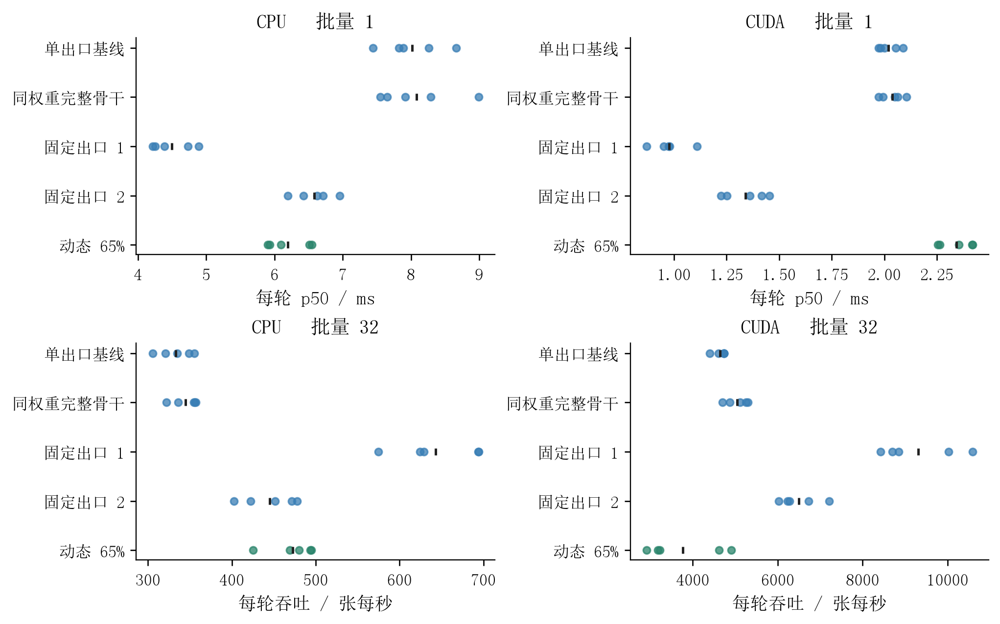

## 4.8 结构与蒸馏的补充对照

GAP 加蒸馏沿用三个原种子、同样训练轮次和蒸馏超参数，训练后在验证集选阈值，并在独立的补充协议锁下测试。该对照设计晚于原测试结果公开，复用同一 CIFAR-100 测试集。种子 42 和 73 在轮次边界恢复检查点后继续训练，种子 17 连续训练。

表 11 结构和蒸馏的四组对照，65% 目标预算

| 模型 | 准确率/% | 计算比/% | 达标种子 |
| --- | --- | --- | --- |
| GAP | 74.73 ± 0.26 | 64.94 ± 0.13 | 2/3 |
| GAP＋蒸馏 | 72.90 ± 0.40 | 62.61 ± 2.22 | 3/3 |
| 局部—全局 | 74.23 ± 0.25 | 64.83 ± 0.88 | 1/3 |
| 局部—全局＋蒸馏 | 75.32 ± 0.19 | 64.36 ± 0.69 | 2/3 |

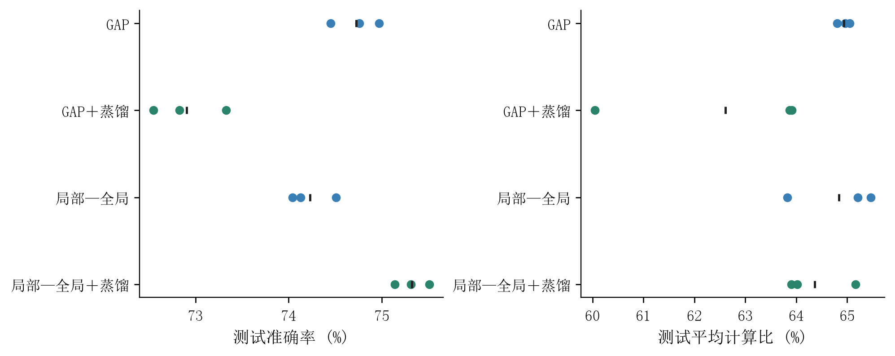

在 65% 目标下，蒸馏对 GAP 和融合的配对准确率差均值分别为 -1.82 和 +1.09 个百分点。两种结构的蒸馏收益之差为 +2.92 个百分点，应结合各组测试实际成本和达标情况解读。此对照区分结构与蒸馏，门控、空间加权和局部卷积的独立贡献仍需更细消融。

## 5 结论

本文构建了基于残差网络的多出口图像分类系统，并通过近等参数出口、自蒸馏和退出策略对照，分析了识别能力与计算预算的关系。测试结果显示，融合加蒸馏在低预算点提供了可量化的计算—准确率权衡；浅层出口的判别能力得到提升。实际计时表明，动态路由的收益取决于设备与执行方式，MACs 不能直接替代延迟。交错计时补充了完整骨干、固定浅层和真实动态路径的比较。测试成本对齐与分出口诊断进一步表明，组合收益随预算变化。其他图像分布与边缘设备上的适配性仍需独立验证。

## 代码与复现

原始实验的代码与运行说明见 GitHub 私有仓库 https://github.com/vgoh64187-ui/adaptive-exit-cnn 。本次补充实验的工作区入口为 revision_gap_kd.py，训练清单为 configs/revision_gap_kd.json。补充协议锁、各轮训练记录和测试预测缓存在 runs/revision/，四组逐种子结果和复算记录见 results/revision/gap_kd_factorial.json。复核并生成表图可运行 assemble_revision.py。

## 参考文献

[1] He K, Zhang X, Ren S, Sun J. Deep Residual Learning for Image Recognition. CVPR, 2016.

[2] Teerapittayanon S, McDanel B, Kung H T. BranchyNet: Fast Inference via Early Exiting from Deep Neural Networks. ICPR, 2016.

[3] Huang G, Chen D, Li T, Wu F, van der Maaten L, Weinberger K Q. Multi-Scale Dense Networks for Resource Efficient Image Classification. ICLR, 2018.

[4] Kaya Y, Hong S, Dumitras T. Shallow-Deep Networks: Understanding and Mitigating Network Overthinking. ICML, PMLR 97, 2019: 3301–3310.

[5] Phuong M, Lampert C H. Distillation-Based Training for Multi-Exit Architectures. ICCV, 2019: 1355–1364.

[6] Xu G, Hao J, Shen L, et al. LGViT: Dynamic Early Exiting for Accelerating Vision Transformer. ACM MM, 2023.

[7] Guo C, Pleiss G, Sun Y, Weinberger K Q. On Calibration of Modern Neural Networks. ICML, PMLR 70, 2017: 1321–1330.

[8] Zhou W, Xu C, Ge T, et al. BERT Loses Patience: Fast and Robust Inference with Early Exit. NeurIPS, 2020.

[9] Zhang Z, Zhu W, Zhang J, et al. PCEE-BERT: Accelerating BERT Inference via Patient and Confident Early Exiting. Findings of NAACL, 2022: 327–338.
